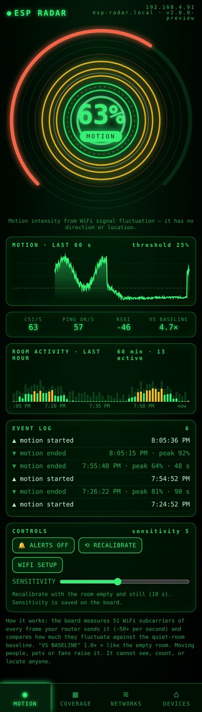
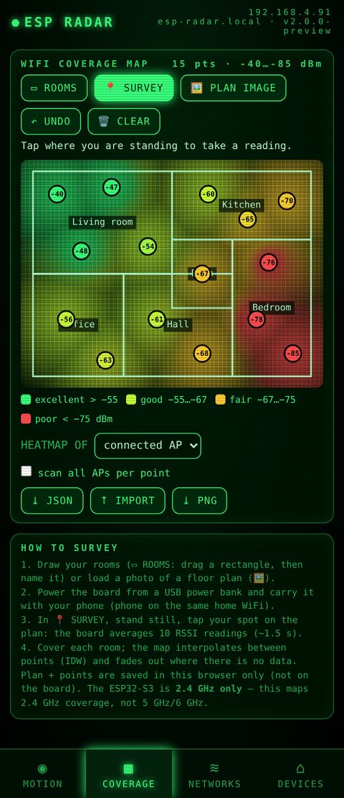
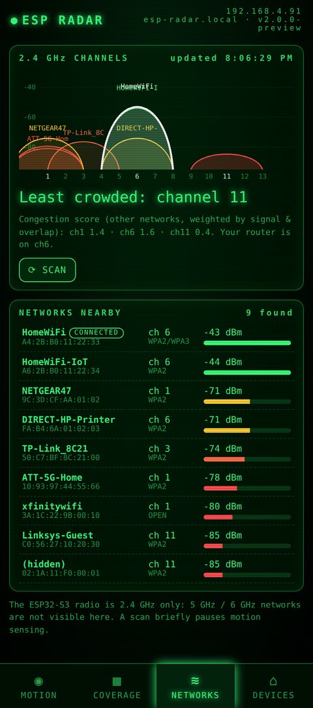
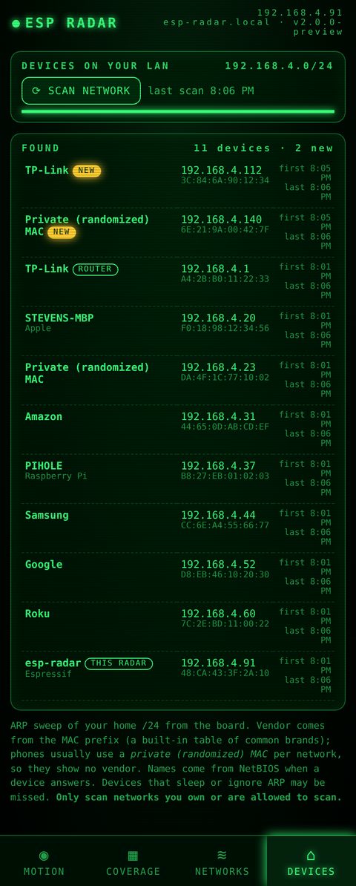

# 📡 ESP Radar v2

**A WiFi toolkit for the Heltec WiFi LoRa 32 V4 (ESP32-S3).** Flash it with one command and open it on your phone:

* **Motion**: a room motion meter built from WiFi *Channel State Information* (CSI), with an event log and a one-hour activity timeline.
* **Coverage**: walk around with the board and build a **WiFi coverage heatmap** of your home on a floor plan you draw or upload.
* **Networks**: nearby 2.4 GHz networks, a channel congestion chart, and a least-crowded channel recommendation (1/6/11).
* **Devices**: what's on your home LAN, with IP, MAC, vendor, name, first/last seen, and **NEW** device highlighting.

<p align="center">
 
 
</p>

> Screenshots: the real v2 web UI rendered in headless Chrome with a **simulated** data feed (`tools/preview_server.py`), not captured from a live board. The images are PNG screenshots wrapped in SVG so they could be committed as text. The original PNGs are in `docs/` locally.

## ⚡ Flash or update with one command

Plug the board in with a USB-C **data** cable, then run:

**Linux / macOS**
```bash
curl -fsSL https://raw.githubusercontent.com/trequanjones612-afk/esp-radar/main/flash.sh | bash
```
**Windows (PowerShell)**
```powershell
irm https://raw.githubusercontent.com/trequanjones612-afk/esp-radar/main/flash.ps1 | iex
```

**Updating from v1 keeps your saved WiFi.** The scripts write the firmware in two pieces: `0x0000–0x8FFF` (bootloader and partition table) and `0xE000–end` (app). They never touch the NVS partition at `0x9000–0xDFFF`, where the WiFi credentials and settings live. The partition table is byte-for-byte the same as v1's. The scripts erase the chip **only** if you set `ESP_RADAR_ERASE=1`.

| Variable | Effect |
|---|---|
| `ESP_RADAR_PORT=/dev/ttyACM0` (or `COM8`) | use this port |
| `ESP_RADAR_ERASE=1` | erase the whole flash first. This **wipes the saved WiFi**; recommended when coming from Meshtastic |
| `ESP_RADAR_DRY_RUN=1` | do everything except write to the board |

The script finds Python 3.8+ and installs `esptool` into a private venv (`~/.local/share/esp-radar` or `%LOCALAPPDATA%\esp-radar`). If Python isn't available it uses Espressif's standalone esptool. It then downloads the firmware, checks its SHA-256, finds the port, and flashes. No sudo or admin rights are needed.

**No-install option:** `web-flasher/index.html` flashes from desktop Chrome or Edge using ESP Web Tools. Serve it over https (GitHub Pages) or from `localhost`, for example `cd web-flasher && python3 -m http.server 8000`. It writes the same two pieces. Leave **Erase device** unticked to keep your WiFi.

## 🚀 First run
1. A new or erased board shows **SETUP MODE** on the OLED. On your phone, join WiFi **`ESP-Radar-XXXX`** (password **`espradar`**) and open **http://192.168.71.1**. Pick your home **2.4 GHz** WiFi.
2. The board joins your WiFi and **calibrates for 10 s. Keep the room still and empty.**
3. Open **http://esp-radar.local**, or the IP shown on the OLED, from your home WiFi. The tabs are **Motion | Coverage | Networks | Devices**.

v2 moved the setup network from `192.168.4.1` to **`192.168.71.1`**. Many home routers use 192.168.4.x, and the overlap broke v1's traffic to the router. If your home LAN happens to be 192.168.71.x, the board moves its setup network to `172.31.71.1` automatically.

## ◉ Motion: what the number means (honestly)
The board keeps pinging your router about 60 times a second. Every frame the router sends back carries CSI: the amplitude of 51 usable OFDM subcarriers. When people move, the radio reflections in the room change, and those amplitudes start to fluctuate.

How the firmware turns that into a number:
1. **Normalize each frame** by its mean amplitude, which cancels the radio's automatic gain changes.
2. **Hampel-style outlier clamp** on each subcarrier, so a single glitchy frame can't trigger motion.
3. **Moving variance** of each subcarrier over the last 50 frames.
4. **Baseline ratio:** each subcarrier's variance is divided by its value during calibration. The score is the **75th percentile** of those ratios. **"VS BASELINE 1.0×"** means the room looks like it did when empty.
5. **Motion %** = (score − 1) scaled by sensitivity. **MOTION** starts at ≥ 25% and ends after 2 s below 12%.
6. **Adaptive baseline:** the baseline slowly re-learns while the room is quiet.

Limits:
* It measures **how much the WiFi signal is being disturbed** near the path between the board and the router. It **cannot see, count, identify, or locate** people. There are no blips: v1's radar blips were decorative and have been removed.
* Someone sitting perfectly still may read as STILL. Fans, pets, curtains, or a moving router can read as motion.
* It needs a good CSI rate. The UI shows **CSI/s** and warns below 20/s; 50+ is the target. **PING OK/S** shows how many pings the router answers. If the router rate-limits ping, the board also sends ARP probes to keep frames coming.
* Results depend on placement: 1–5 m from the router, with you between them. **Recalibrate** after moving the board, using the button in the UI or a short press on PRG.

The Motion tab also has a **room activity** chart (per-minute average and peak for the last hour; amber = mostly motion), an **event log** (motion started/ended, with the peak and duration, in your phone's clock), alerts (vibrate and beep), recalibrate, and a sensitivity slider (saved on the board).

## ▦ Coverage: how to survey your home
1. On the **Coverage** tab, either draw your rooms (**▭ ROOMS**: drag a rectangle, then name it) or load a photo or screenshot of a floor plan (**🖼 PLAN IMAGE**).
2. Power the board from a USB power bank and carry it with your phone. Both stay on your home WiFi.
3. In **📍 SURVEY**, stand still and tap your position on the plan. The board averages **10 RSSI readings (~1.5 s)** of the access point it's connected to, and the point is colored: **excellent > −55**, **good −55…−67**, **fair −67…−75**, **poor < −75 dBm**.
4. Cover every room, including corners and the places you actually use WiFi. The heatmap interpolates between points (inverse-distance weighting) and **fades out where you have no readings** instead of guessing.
5. Optional: tick **scan all APs per point**. Each point then also records the RSSI of every visible access point, and you can choose which AP or mesh node the heatmap shows.
6. **↶ UNDO**, **🗑 CLEAR**, **⤓ JSON / ⤒ IMPORT** (back up or move a survey), and **⤓ PNG** (heatmap plus legend).

The plan and points are stored **in your phone's browser** (localStorage), not on the board. The ESP32-S3 is **2.4 GHz only**, so this maps 2.4 GHz coverage, not 5 or 6 GHz. Its antenna differs from a phone's, so treat the dBm values as relative.

## ≋ Networks
A WiFi scan from the board lists SSID, BSSID, channel, RSSI, and security, and draws a channel chart (each network as a hump across the channels it overlaps). The congestion score for channels 1, 6, and 11 weights the other networks by signal strength and channel overlap, and the lowest score is recommended. 2.4 GHz only. A scan briefly pauses motion sensing.

## ⌂ Devices (use only on networks you own)
The board ARP-sweeps your home /24 in small chunks, so it doesn't block anything, in about 15 s. For each device it shows:
* **IP and MAC.**
* **Vendor**, from a built-in table of 12.7k MAC prefixes (OUIs) for about 90 common consumer brands. Phones usually use **private (randomized) MACs**, so they show no vendor.
* **Name**, via NetBIOS, when the device answers.
* **First and last seen.**

The board remembers the MACs it has seen in its own NVS namespace (`espradar-dev`), so devices that appear in later scans get a **NEW** tag. Devices that sleep or ignore ARP can be missed. **Only scan networks you own or have permission to scan.**

## 🎛 Buttons and display
| | |
|---|---|
| **PRG** short press | recalibrate (room still) |
| **PRG** hold 3 s | forget WiFi and restart into setup mode |
| **OLED** | IP, motion %, STILL/MOTION/NO CSI, CSI rate, a real motion bar with the 25% threshold tick, and the last ~2 minutes of motion history (one column per second) |
| **LED** | blinks while motion is detected |
| **Serial (115200)** | CSV at 10 Hz: `ms,level,state,proximity,rssi,csi_pps,csi_all_pps,ping_ok_ps,score` |

## ⚠️ Security and limits
* The setup network uses a fixed, published password (`espradar`), and the web UI has no login. Anyone on the setup network or your LAN can view it and change the WiFi settings. Treat it as a hobby device.
* v2 has **not yet been tested on real hardware** (v1 was). The CSI thresholds may need tuning in your room; use the sensitivity slider.

## 🔙 Back to Meshtastic
Go to **https://flasher.meshtastic.org** in Chrome or Edge → **Heltec V4** → pick a version → enable **Full Erase and Install** → flash.

## 🛠 Troubleshooting
* **No port or "Failed to connect":** use a data cable. Enter download mode by **holding PRG, tapping RST, and releasing PRG**, then run the command again. Close any serial monitor that might be holding the port.
* **Linux "Permission denied":** run `sudo usermod -aG dialout $USER` (`uucp` on Arch), then log out and back in.
* **"NO CSI" or CSI/s below 20:** move the board closer to the router, and check that the router answers ping (see PING OK/S). The 2.4 GHz band must be enabled.
* **Always MOTION:** recalibrate with the room empty, or lower the sensitivity.
* **esp-radar.local doesn't resolve** (common on Android): use the IP shown on the OLED.
* **Blank OLED:** press RST. The OLED is powered through Vext (GPIO36, active LOW).

## 🧩 Hardware (Heltec WiFi LoRa 32 V4)
OLED SDA/SCL/RST = GPIO 17/18/21, Vext = GPIO36 (active LOW), PRG = GPIO0, LED = GPIO35. Sources: Heltec's `pins_arduino.h` (arduino-esp32 `heltec_wifi_lora_32_V4`) and Meshtastic's `heltec_v4` variant. The OLED is an SSD1306-compatible display at 0x3C. The LoRa radio is not used.

## 🏗 Build from source
`firmware/esp-radar-heltec-v4.bin.b64` is the merged image (bootloader `0x0`, partitions `0x8000`, boot_app0 `0xE000`, app `0x10000`), stored as base64 text. `…bin.sha256` is the checksum of the decoded `.bin`.

Toolchain: **arduino-cli 1.6.0** with **arduino-esp32 3.3.13**, board `heltec_wifi_lora_32_V4`, partition scheme `no_ota` (NVS `0x9000`/`0x5000`, app `0x10000`/2 MB, unchanged from v1), USB CDC on boot. Libraries: ESP Async WebServer 3.12.1, Async TCP 3.6.1, and the ThingPulse SSD1306 driver 4.6.2. Web pages are gzipped into flash (`tools/embed_web.py`) and served with `Content-Encoding: gzip`.
```bash
arduino-cli core install esp32:esp32@3.3.13
arduino-cli lib install "ESP Async WebServer@3.12.1" "Async TCP@3.6.1" "ESP8266 and ESP32 OLED driver for SSD1306 displays@4.6.2"
tools/build.sh                     # embed web/*.html (gzip) -> compile -> merge -> firmware/*.b64 + .sha256
python3 tools/gen_oui.py manuf.txt # optional: regenerate the vendor table from Wireshark's manuf file
python3 tools/preview_server.py    # preview the phone UI with fake data at http://127.0.0.1:8080
```

## 📝 Changelog
**2.0.0**
* **Motion fix:** the setup AP moved to `192.168.71.1`. v1's `192.168.4.1` collided with home LANs on 192.168.4.x; the gateway ping then never reached the router, which left about 8 CSI frames/s (beacons only).
* Pings now bind to the home WiFi interface and run every 15 ms, with ARP probes as a fallback when the router rate-limits ping. Power save is off (`WIFI_PS_NONE`), and CSI is captured from every frame the AP sends (LLTF plus HT-LTF). The CSI rate, ping rate, and total frame rate are shown in the UI, on the OLED, and in the serial CSV.
* **New motion metric:** per-frame normalization, Hampel outlier clamp, per-subcarrier moving variance against a per-subcarrier calibrated baseline (75th-percentile ratio), and an adaptive baseline. Motion reads 0 when the CSI rate is below 5/s.
* **Honest UI:** the fake radar blips are gone. In their place are a motion meter (rings and pulses driven by the real score), a one-hour activity timeline, an event log with durations, and a "VS BASELINE ×" readout. The OLED shows a real motion bar and a 2-minute history.
* **New tabs:** Coverage mapper (draw or upload a plan, survey, IDW heatmap, per-AP layers, JSON/PNG export), Networks (scan, channel chart, 1/6/11 recommendation), and Devices (ARP sweep, vendor table, NetBIOS names, NEW-device highlighting).
* **Updates keep your WiFi settings:** the flashers skip the NVS region. v1's single merged write at `0x0` padded `0x9000–0xDFFF` with `0xFF`, which wiped saved WiFi. Erasing now happens only with `ESP_RADAR_ERASE=1`.
* Web assets are gzipped, and the version (2.0.0) is shown in the UI, on the OLED, and over serial.

**1.0.0**: first release (CSI motion radar, OLED and phone UI, one-command flashers).

## License
MIT. See [LICENSE](LICENSE). The vendor table is derived from the public IEEE OUI registry, via Wireshark's `manuf` file.
