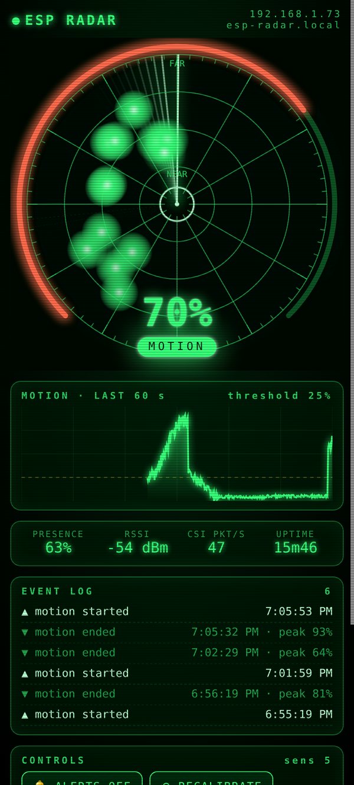
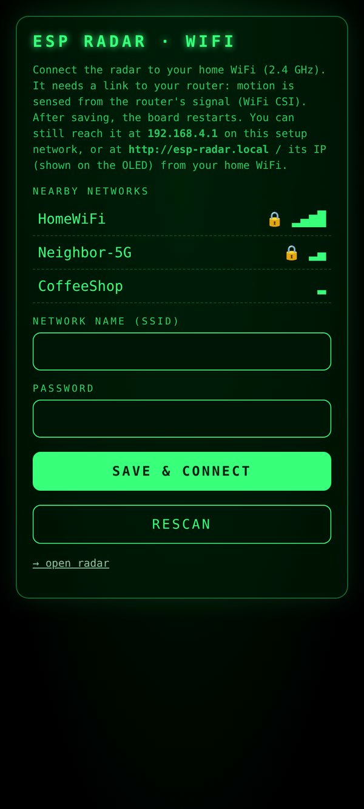

# 📡 ESP Radar

**A WiFi motion radar for the Heltec WiFi LoRa 32 V4.** It reads WiFi *Channel State Information* (CSI) from your router and shows how much movement is around the board: an animated radar sweep on the OLED and a full-screen green-phosphor radar in your phone's browser.

<p align="center"> &nbsp; </p>

> Screenshots (PNG wrapped in SVG so they could be committed as text): the real web UI from this repo, rendered in headless Chrome with a **simulated** data feed (`tools/preview_server.py`), not a recording from a live board.

## ⚡ Flash it with one command

Plug the board in with a USB-C **data** cable, then run:

**Linux / macOS**
```bash
curl -fsSL https://raw.githubusercontent.com/trequanjones612-afk/esp-radar/main/flash.sh | bash
```

**Windows (PowerShell)**
```powershell
irm https://raw.githubusercontent.com/trequanjones612-afk/esp-radar/main/flash.ps1 | iex
```

What the script does (no sudo or admin rights needed):
1. Finds Python 3.8+ and installs `esptool` into a private venv (`~/.local/share/esp-radar` or `%LOCALAPPDATA%\esp-radar`). If Python or venv isn't available, it downloads Espressif's standalone esptool instead.
2. Downloads the prebuilt firmware and checks its SHA-256.
3. Finds the board's serial port (`/dev/ttyACM*`, `/dev/ttyUSB*`, `/dev/cu.usbmodem*`, or the COM port on Windows). It waits up to 60 s for you to plug it in.
4. Flashes it with `esptool --chip esp32s3 write_flash 0x0 …`.

Options (environment variables):

| Variable | Effect |
|---|---|
| `ESP_RADAR_PORT=/dev/ttyACM0` (or `COM5`) | use this port |
| `ESP_RADAR_ERASE=1` | erase the whole flash first (**recommended when coming from Meshtastic**) |
| `ESP_RADAR_DRY_RUN=1` | do everything except write to the board |

For example: `curl -fsSL …/flash.sh | ESP_RADAR_ERASE=1 bash`, or in PowerShell `$env:ESP_RADAR_ERASE="1"; irm …/flash.ps1 | iex`.

### No-install option: web flasher
`web-flasher/index.html` uses [ESP Web Tools](https://esphome.github.io/esp-web-tools/) to flash from desktop Chrome or Edge over Web Serial. Web Serial needs `https://` or `localhost`, so either turn on GitHub Pages for this repo and open `/web-flasher/`, or run it locally:
```bash
git clone https://github.com/trequanjones612-afk/esp-radar && cd esp-radar/web-flasher && python3 -m http.server 8000
# open http://localhost:8000 in Chrome
```
The page downloads the firmware, checks its SHA-256 in the browser, and hands it to ESP Web Tools.

## 🚀 First run
1. The OLED shows **SETUP MODE**. On your phone, join WiFi **`ESP-Radar-XXXX`** (password **`espradar`**).
2. A setup page should pop up. If it doesn't, open **http://192.168.4.1**. Pick your home **2.4 GHz** network and enter the password.
3. The board restarts, joins your WiFi, and **calibrates for about 10 s. Keep the room still and empty.**
4. Open the radar at **http://esp-radar.local** (or the IP shown on the OLED) from your home WiFi, or at **http://192.168.4.1** while on the `ESP-Radar-XXXX` network. The board keeps its own access point running alongside the home connection.

## 🎛 Controls
| Where | Action |
|---|---|
| **PRG** short press | recalibrate the baseline (do this with the room still) |
| **PRG** hold 3 s | forget the saved WiFi and restart into setup mode |
| Web UI · 🔔 ALERTS | vibrate and beep on the phone when motion starts (tap once so the browser allows sound) |
| Web UI · RECALIBRATE / SENSITIVITY | same as the button / 1–10 slider, saved on the board |
| Web UI · WIFI | change networks (`/setup`) |

**OLED:** the status line shows the IP and motion %. Below it are an animated radar sweep with blips, the STILL/MOTION state, a motion bar, a rough "near %", RSSI, and the CSI packet rate.

**Phone UI:** full-screen canvas radar with a sweep, glowing blips, and a motion gauge around the rim; a live 60-second motion graph; an event log ("▲ motion started 6:52 PM"); presence %, RSSI, CSI packets/s, and uptime. Data arrives as a Server-Sent Events stream at about 8 Hz, with a polling fallback. Everything is embedded in the firmware, with no CDN or internet needed.

**Serial (115200):** CSV at 10 Hz for logging/plotting:
```
ms,level,state,proximity,rssi,pps,score,baseline,sigma
```

## 🧠 How it works
* The board stays connected to your router and **pings the gateway about 50 times a second**, so the router keeps sending frames. Each frame carries CSI: amplitude and phase for 64 OFDM subcarriers.
* For every frame from *your* router (filtered by BSSID), the firmware takes the 51 usable LLTF subcarrier amplitudes and normalizes them by their mean, which cancels automatic gain changes. A 48-packet sliding window tracks the **variance of each subcarrier**.
* People moving change the multipath, so the variance jumps. The **motion score** is the mean subcarrier variance.
* **Calibration** (10 s at boot or on a PRG press) learns the still-room baseline and its noise (σ). The 0–100 **motion level** is roughly how many σ above baseline the score is, scaled by sensitivity. **MOTION** starts at ≥ 25 and ends after 2 s below 12 (hysteresis). The baseline slowly re-adapts while the room is still.
* **"Near / proximity"** is a rough blend of disturbance strength and RSSI drop and jitter. Bigger, closer disturbances read higher.

## ⚠️ Honest limits
* This measures **motion/presence intensity**, not people. It **cannot count, identify, or locate individuals**, and it can't see through walls in any camera-like sense. The radar blips and their distance are a **visualization** of intensity and the rough proximity guess, not positions.
* A perfectly still person can read as "still". Fans, pets, curtains, a washing machine, or other WiFi traffic can trigger motion.
* Results depend heavily on placement. The best spot is between you and the router, 1–5 m away, with the router itself not moving. Recalibrate after moving the board.
* It needs a **2.4 GHz** router connection. Mesh systems that hop channels or band-steer can make the readings noisy.
* The setup AP uses a fixed, published password (`espradar`), and the web UI has no login. Anyone on the AP or your LAN can view it and change the WiFi settings. Treat it as a toy or hobby device.
* **Not yet tested on real hardware.** It compiles cleanly and the tools were tested, but the CSI thresholds may need tuning in your room (use the sensitivity slider).

## 🔙 Going back to Meshtastic
Open **https://flasher.meshtastic.org** in Chrome or Edge, choose **Heltec V4**, pick a firmware version, turn on **Full Erase and Install**, and flash. The Meshtastic flasher erases ESP Radar completely.

## 🛠 Troubleshooting
* **No port found or "Failed to connect":** use a data-capable USB-C cable. Then enter download mode by **holding PRG, tapping RST, and releasing PRG**, and run the command again. Close Arduino IDE, Meshtastic, or any serial monitor that might be holding the port.
* **Linux "Permission denied" on /dev/ttyACM0:** run `sudo usermod -aG dialout $USER` (`uucp` on Arch), then log out and back in.
* **Windows has no COM port:** install the Espressif USB-JTAG/serial driver through Windows Update, or try another USB port. Set `$env:ESP_RADAR_PORT="COM5"` to force a port.
* **Blank OLED:** the OLED is powered through Vext (GPIO36, active LOW), which the firmware switches on. Press RST once.
* **The OLED says "low CSI!" or shows few packets/s:** the router isn't sending enough frames. Move the board closer, and check that it's on 2.4 GHz.
* **Always "MOTION":** press PRG to recalibrate with the room empty, or lower the sensitivity.
* **Coming from Meshtastic and the board acts strangely:** flash with `ESP_RADAR_ERASE=1`.
* **esp-radar.local doesn't resolve:** Android often lacks mDNS. Use the IP shown on the OLED.

## 🧩 Hardware details (Heltec WiFi LoRa 32 V4)
| Function | GPIO | Source |
|---|---|---|
| OLED SDA / SCL / RST | 17 / 18 / 21 | Heltec `pins_arduino.h` (arduino-esp32 `heltec_wifi_lora_32_V4`) and the Meshtastic `heltec_v4` variant |
| Vext (OLED power, active LOW) | 36 | same |
| PRG button | 0 | same |
| White LED (blinks on motion) | 35 | same |

The OLED is an SSD1306-compatible display (SSD1315) at I²C address 0x3C. The LoRa radio is not used.

## 🏗 Building from source
Prebuilt: `firmware/esp-radar-heltec-v4.bin.b64` is the merged image (bootloader + partitions + boot_app0 + app, flashed at 0x0), stored as **base64 text** because the publishing tool can only commit text files. `…bin.sha256` is the checksum of the decoded `.bin`. To decode it yourself: `base64 -d firmware/esp-radar-heltec-v4.bin.b64 > esp-radar.bin`.

Toolchain used: **arduino-cli 1.6.0**, **arduino-esp32 core 3.3.13** (ESP-IDF 5.5-based, CSI enabled in its sdkconfig), board `heltec_wifi_lora_32_V4`, partition scheme `no_ota` (2 MB app), USB CDC on boot. Libraries: ESP Async WebServer 3.12.1, Async TCP 3.6.1, and the ThingPulse SSD1306 driver 4.6.2.
```bash
arduino-cli core install esp32:esp32@3.3.13   # board index: https://espressif.github.io/arduino-esp32/package_esp32_index.json
arduino-cli lib install "ESP Async WebServer@3.12.1" "Async TCP@3.6.1" "ESP8266 and ESP32 OLED driver for SSD1306 displays@4.6.2"
tools/build.sh            # embeds web/*.html -> src/esp_radar/web_ui.h, compiles, merges, writes firmware/
python3 tools/preview_server.py   # preview the phone UI with fake data at http://127.0.0.1:8080
```

## License
MIT. See [LICENSE](LICENSE).
