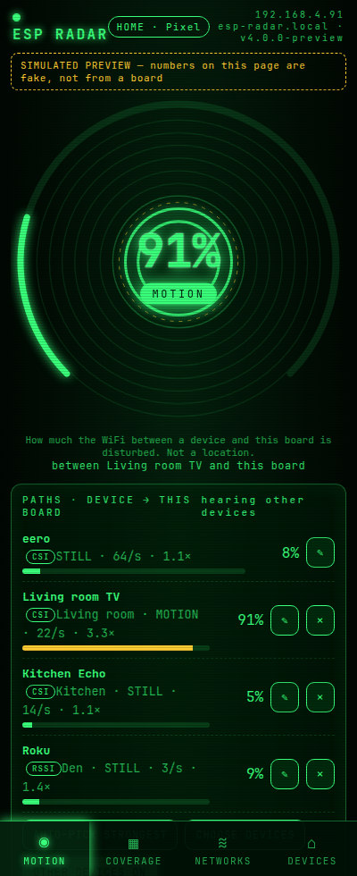
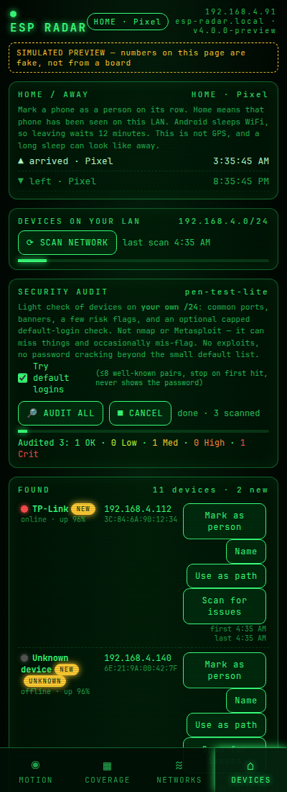
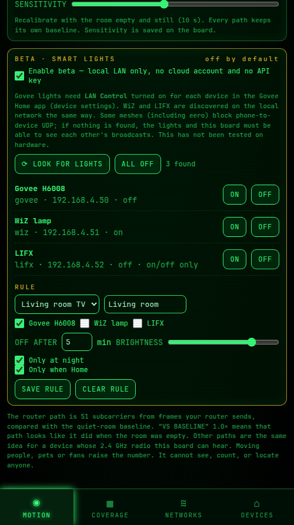

# 📡 ESP Radar v4.1

**A WiFi toolkit for the Heltec WiFi LoRa 32 V4 (ESP32-S3).** Flash it with one command and open it on your phone:

* **Motion**: a motion meter for the path between the board and your router, plus a few other always-on 2.4 GHz devices (a TV, an Echo, a console). Each meter is that device-to-board path — which path is disturbed, not where someone is standing.
* **Home / Away**: mark your phones as people. The OLED and the UI say home or away from presence on the LAN, with a long debounce because Android sleeps its WiFi.
* **Devices**: who's on the LAN, plus a light health view (uptime, last dropout, flapping, overnight activity, new or unknown joins). The v3 security audit is still there and unchanged.
* **Beta lights** (off until you turn it on): local on/off and brightness for Govee (LAN Control), plus WiZ and on/off for LIFX. No cloud account and no API key. A motion path can turn chosen lights on and off again after a timeout.
* **Coverage** and **Networks**: the same v3 tools (walk-around heatmap, 2.4 GHz channel chart).

<p align="center">
 

</p>

> Screenshots: the v4 web UI rendered in headless Chrome with a **simulated** data feed (`tools/preview_server.py`), not captured from a live board. The yellow banner on each image says so. v3 screenshots are still in `docs/`.

**Not tested on hardware.** v3 runs on a real Heltec V4. This v4 firmware compiles with the same toolchain and keeps the same flash layout, but it has not been flashed to a board. CSI from other transmitters uses the API Espressif documents for the ESP32-S3 (promiscuous mode). Whether a particular eero channel, Echo, or Govee bulb behaves is untested. Treat the new numbers as unproven until you recalibrate in an empty room and watch them.

## ⚡ Flash or update with one command

Plug the board in with a USB-C **data** cable, then run:

**Linux / macOS**
```bash
curl -fsSL https://raw.githubusercontent.com/trequanjones612-afk/esp-radar/main/flash.sh | bash
```
**Windows (PowerShell)**
```powershell
irm https://raw.githubusercontent.com/trequanjones612-afk/esp-radar/main/flash.ps1 | iex
```

**Updating from v1 keeps your saved WiFi.** The scripts write the firmware in two pieces: `0x0000–0x8FFF` (bootloader and partition table) and `0xE000–end` (app). They never touch the NVS partition at `0x9000–0xDFFF`, where the WiFi credentials and settings live. The partition table is byte-for-byte the same as v1's. The scripts erase the chip **only** if you set `ESP_RADAR_ERASE=1`.

| Variable | Effect |
|---|---|
| `ESP_RADAR_PORT=/dev/ttyACM0` (or `COM8`) | use this port |
| `ESP_RADAR_ERASE=1` | erase the whole flash first. This **wipes the saved WiFi**; recommended when coming from Meshtastic |
| `ESP_RADAR_DRY_RUN=1` | do everything except write to the board |

The script finds Python 3.8+ and installs `esptool` into a private venv (`~/.local/share/esp-radar` or `%LOCALAPPDATA%\esp-radar`). If Python isn't available it uses Espressif's standalone esptool. It then downloads the firmware, checks its SHA-256, finds the port, and flashes. No sudo or admin rights are needed.

**No-install option:** `web-flasher/index.html` flashes from desktop Chrome or Edge using ESP Web Tools. Serve it over https (GitHub Pages) or from `localhost`, for example `cd web-flasher && python3 -m http.server 8000`. It writes the same two pieces. Leave **Erase device** unticked to keep your WiFi.

## 🚀 First run
1. A new or erased board shows **SETUP MODE** on the OLED. On your phone, join WiFi **`ESP-Radar-XXXX`** (password **`espradar`**) and open **http://192.168.71.1**. Pick your home **2.4 GHz** WiFi.
2. The board joins your WiFi and **calibrates for 10 s. Keep the room still and empty.**
3. Open **http://esp-radar.local**, or the IP shown on the OLED, from your home WiFi. The tabs are **Motion | Coverage | Networks | Devices**.

v2 moved the setup network from `192.168.4.1` to **`192.168.71.1`**. Many home routers use 192.168.4.x, and the overlap broke v1's traffic to the router. If your home LAN happens to be 192.168.71.x, the board moves its setup network to `172.31.71.1` automatically.

## ◉ Motion: what the number means (honestly)
The board keeps pinging your router about 60 times a second. Every frame the router sends back carries CSI: the amplitude of 51 usable OFDM subcarriers. When people move, the radio reflections along that path change, and those amplitudes start to fluctuate. That router path is the same meter v3 had.

**Other devices.** A connected station normally only receives frames from its access point, so v3 could not see CSI from an Echo or a TV. Espressif's ESP32-S3 CSI guide says to turn on promiscuous (sniffer) mode to receive CSI from other transmitters. v4 does that, and tags each frame by the transmitter MAC. You pick the links, or tap **Auto-pick strongest**, which takes the few (up to 5, plus the router) radios this board actually hears on its 2.4 GHz channel — frequent and reasonably strong, skipping randomized phone MACs. Each link has its own calibration, baseline, and motion word. The big number follows the loudest path and reads like "between the living-room TV and this board".

What that is **not**: a position, a person count, or a camera. A path lights up when the radio between that device and the board is disturbed. Someone can walk through one path and miss another. Two paths can fire for one person. A fan in front of the TV can look like motion on that path only.

**5 GHz is invisible.** The ESP32-S3 is 2.4 GHz only. An eero often puts Echos, TVs, and consoles on 5 GHz. Those devices still show up in the Devices tab if they answer ARP (the mesh bridges them), but they will not become a motion path, because this board never hears their radio. The path list only offers devices heard as transmitters on this channel. If a chosen link never sends CSI frames, the row stays at "no frames" or, when we still see its signal strength, falls back to **RSSI** variance — a weaker motion estimate, labeled RSSI, not CSI.

There is a button, **Other devices on/off**, if the sniffer ever causes trouble. Router CSI keeps working with it off. That is the v3 behavior.

How the firmware turns that into a number:
1. **Normalize each frame** by its mean amplitude, which cancels the radio's automatic gain changes.
2. **Hampel-style outlier clamp** on each subcarrier, so a single glitchy frame can't trigger motion.
3. **Moving variance** of each subcarrier over the last 50 frames.
4. **Baseline ratio:** each subcarrier's variance is divided by its value during calibration. The score is the **75th percentile** of those ratios. **"VS BASELINE 1.0×"** means the room looks like it did when empty.
5. **Motion %** = (score − 1) scaled by sensitivity. **MOTION** starts at ≥ 25% and ends after 2 s below 12%.
6. **Adaptive baseline:** the baseline slowly re-learns while the room is quiet.

Limits:
* It measures **how much the WiFi signal is being disturbed** along one device-to-board path (the router, unless you are looking at another link). It **cannot see, count, identify, or locate** people. There are no blips: v1's radar blips were decorative and have been removed. The same six steps run separately on every path.
* Someone sitting perfectly still may read as STILL. Fans, pets, curtains, or a moving router can read as motion.
* It needs a good CSI rate. The UI shows **CSI/s** and warns below 20/s; 50+ is the target. **PING OK/S** shows how many pings the router answers. If the router rate-limits ping, the board also sends ARP probes to keep frames coming.
* Results depend on placement: 1–5 m from the router, with you between them. **Recalibrate** after moving the board, using the button in the UI or a short press on PRG.

The Motion tab also has a **router-path activity** chart (per-minute average and peak for the last hour; amber = mostly motion), an **event log** (motion started/ended on a named path, with the peak and duration, in your phone's clock), alerts (vibrate and beep), recalibrate (every path, room still), and a sensitivity slider (saved on the board, shared by every path).

The OLED shows HOME or AWAY, the loudest path's percent, and MOTION if any path is in motion. The serial CSV is unchanged through `score`, then adds `home` and how many paths are in motion.

## ▦ Coverage: how to survey your home
1. On the **Coverage** tab, either draw your rooms (**▭ ROOMS**: drag a rectangle, then name it) or load a photo or screenshot of a floor plan (**🖼 PLAN IMAGE**).
2. Power the board from a USB power bank and carry it with your phone. Both stay on your home WiFi.
3. In **📍 SURVEY**, stand still and tap your position on the plan. The board averages **10 RSSI readings (~1.5 s)** of the access point it's connected to, and the point is colored: **excellent > −55**, **good −55…−67**, **fair −67…−75**, **poor < −75 dBm**.
4. Cover every room, including corners and the places you actually use WiFi. The heatmap interpolates between points (inverse-distance weighting) and **fades out where you have no readings** instead of guessing.
5. Optional: tick **scan all APs per point**. Each point then also records the RSSI of every visible access point, and you can choose which AP or mesh node the heatmap shows.
6. **↶ UNDO**, **🗑 CLEAR**, **⤓ JSON / ⤒ IMPORT** (back up or move a survey), and **⤓ PNG** (heatmap plus legend).

The plan and points are stored **in your phone's browser** (localStorage), not on the board. The ESP32-S3 is **2.4 GHz only**, so this maps 2.4 GHz coverage, not 5 or 6 GHz. Its antenna differs from a phone's, so treat the dBm values as relative.

## ≋ Networks
A WiFi scan from the board lists SSID, BSSID, channel, RSSI, and security, and draws a channel chart (each network as a hump across the channels it overlaps). The congestion score for channels 1, 6, and 11 weights the other networks by signal strength and channel overlap, and the lowest score is recommended. 2.4 GHz only. A scan briefly pauses motion sensing.

## ⌂ Devices (use only on networks you own)
The board ARP-sweeps your home /24 in small chunks, so it doesn't block anything, in about 15 s. For each device it shows:
* **IP and MAC.**
* **Vendor**, from a built-in table of 12.7k MAC prefixes (OUIs) for about 90 common consumer brands. Phones usually use **private (randomized) MACs**, so they show no vendor.
* **Name**, via NetBIOS, when the device answers.
* **First and last seen.**
* A severity badge once you've audited it (colored dot: OK / Low / Medium / High / Critical).

The board remembers the MACs it has seen in its own NVS namespace (`espradar-dev`), so devices that appear in later scans get a **NEW** tag. A join with no vendor in the built-in table is also marked **UNKNOWN**. Devices that sleep or ignore ARP can be missed. **Only scan networks you own or have permission to scan.**

### Device health
From the same ARP discovery (a slow background pass plus the Scan button — not a port scan), each row tracks:

* **Online / offline**, and **uptime %** once it has been watched for about 15 minutes.
* **Last dropout** (when it went from online to offline).
* **Flapping** if it changes state several times; the count decays so a one-off blip fades.
* **Overnight** if it was seen between midnight and 6am on your phone's clock (the UI sends the timezone).
* A **2.4 GHz radio heard** note when the sniffer has actually received that MAC on this channel.

This is a small record in RAM and in the `espradar-dev` namespace (`hlth`). It does not survive as a full history, and a stale ARP entry can make a quiet device look online for a few minutes. WiFi credentials stay in the original `espradar` namespace and are not rewritten by this.

### Home / Away
On a device row, **Mark as person** (up to 8, meant for phones). **Home** means at least one of those phones has been seen on the LAN. **Away** means none of them have been seen for **12 minutes**. Arriving takes two fresh sightings, so one stray frame does not count. Android sleeps WiFi for long stretches; the 12 minute leave timer is there so a nap of the radio is not a departure. A phone that stays asleep longer than that, or that the mesh answers for without the phone transmitting, can read as away while you are home. This is presence on the LAN, not GPS.

Arrivals and departures are logged (OLED does not list them; the Devices tab does) and kept across reboot in the same small NVS record. The header on every tab shows HOME, AWAY, CHECKING (the first 90 seconds), or NO PEOPLE.

### 🔎 Security audit (pen-test-lite)
On each device row, **Scan for issues** runs a light audit of that IP from the board. **Audit all** walks the discovered list sequentially. Progress shows while it runs; motion sensing continues between devices.

What it does (all on the board, chunked, non-blocking):
1. **TCP connect-scan** of 29 common ports: 21 FTP, 22 SSH, 23 Telnet, 25 SMTP, 53 DNS, 80 HTTP, 110 POP3, 135 MSRPC, 139/445 SMB, 143 IMAP, 443 HTTPS, 554 RTSP, 587 SMTP-sub, 1883 MQTT, 2323 Telnet-alt, 3389 RDP, 5000 HTTP/UPnP, 5357 WSD, 7547 TR-069, 8000/8080/8081/8443/9000 alt-HTTP(S), 8554 RTSP-alt, 37777 Dahua, 49152 UPnP, 32764 (historical router backdoor).
2. **Banner / service grab** on open ports (FTP/SSH/SMTP/Telnet greeting; HTTP GET / for Server, status, WWW-Authenticate, `<title>`). HTTPS connects with an *unverified* TLS client and notes that — if memory is tight, 443 is marked "HTTPS (not inspected)".
3. **Risk flags** from the above: Telnet open (High), FTP cleartext (Medium), plain-HTTP admin (Low/Medium), TR-069/7547 (Medium), SMB (Medium), RTSP/camera (Medium), RDP (High), dated banners via a small static hint table (Low–Medium — **not** a CVE database), possible 32764 backdoor (High).
4. **Default-credential check (optional, default ON):** only against an HTTP(S) login that advertised Basic auth, and only a **capped list of 7 universal pairs** (`admin/admin`, `admin/password`, `admin/(blank)`, `root/root`, `user/user`, `admin/1234`, `support/support`) plus **at most one** vendor-specific pair (e.g. `ubnt/ubnt` for Ubiquiti) → **≤ 8 tries total**. One pass, delay between attempts, **stops on the first success**, reports Critical *"default credentials accepted"* **without showing the password**, never retries, never leaves your /24. Toggle: **Try default logins**.

**Guardrails (built in):** only IPs on the board's own /24 are accepted (everything else, including a WAN address, is rejected). No exploits, no payloads, no password cracking beyond that capped list. The UI and this README say clearly: this is a light audit for networks you own, not nmap/Metasploit; it can miss things and occasionally mis-flag. v4 does not add ports, credentials, or checks to this audit.

## 💡 Beta smart lights (off by default)
On the Motion tab, **BETA · SMART LIGHTS** is off until you turn it on. Nothing is discovered and no UDP is sent until then. There is no Govee / WiZ / LIFX account and no API key. Commands stay on your LAN.

**Govee:** in the Govee Home app, open each light → settings → **LAN Control**, and turn it on. Only some Govee models implement that switch. The board still multicasts to `239.255.255.250:4001` and broadcasts, and **v4.1 also unicasts** a scan to each known host’s port 4001 (replies on UDP 4002, commands to port 4003), because eero often drops the broadcast. The diagnostics line is `sent → replies`. Zero replies after a unicast sweep means those bulbs did not answer, which is LAN Control off or an unsupported model, not a missing packet.

**WiZ** (on/off and brightness, unicast `getPilot` to UDP 38899) and **LIFX** (on/off only, unicast GetService to UDP 56700; brightness would change the color, so it is not sent) use the same rule engine. **Tuya and CloudyBay** are listed when UDP 6666/6667 is heard or TCP 6668 answers. They need a local key you type in; it is stored only on the board and is not shown again. Control uses DPs 20/22, then 1/2. Protocol 3.3, 3.4 and 3.5 are implemented from the public local protocol and are **untested on hardware**. GE Cync is not included: it has no local API that works without an account.

**Rules (one in the UI, up to four in the firmware):** motion on a chosen path, any path, or a room label you typed on a path, turns the chosen lights on. They turn off N minutes after that motion stops (1–180, default 5). Optional: only at night (default 19:00–07:00, using the timezone your phone sends), and/or only when Home. **ON / OFF** next to a found light is a manual test. **ALL OFF** is the panic button.

eero and other meshes sometimes drop client-to-client multicast and broadcast. If a scan finds nothing, LAN Control may be off, or the mesh is not delivering UDP between the board and the bulbs. This whole feature is **untested on hardware**.

## 🎛 Buttons and display
| | |
|---|---|
| **PRG** short press | recalibrate (room still) |
| **PRG** hold 3 s | forget WiFi and restart into setup mode |
| **OLED** | IP, HOME/AWAY/CHK, the loudest path's %, STILL/MOTION/NO CSI, a motion bar with the 25% tick, and the last ~2 minutes of that level (one column per second). CALIBRATING still takes the screen for the router path's first 10 s |
| **LED** | blinks while any path is in motion |
| **Serial (115200)** | CSV at 10 Hz: `ms,level,state,proximity,rssi,csi_pps,csi_all_pps,ping_ok_ps,score,home,paths`. The first nine columns are still the **router** path, same as v3. `home` is HOME/AWAY/CHK/----. `paths` is how many paths are in motion |

## ⚠️ Security and limits
* The setup network uses a fixed, published password (`espradar`), and the web UI has no login. Anyone on the setup network or your LAN can view it, change the WiFi settings, and (if you enabled Beta) turn your lights on and off. Treat it as a hobby device.
* v2 was tested on real Heltec V4 hardware (CSI ~79/s, Devices ~48 hosts). v3's audit has **not** been run against real devices yet. **v4's multi-path CSI, health, home/away, and lights have not been run on hardware at all.** The CSI thresholds may need tuning in your room; use the sensitivity slider. If "other devices" makes the router link worse, turn that sniffer off.

## 🔙 Back to Meshtastic
Go to **https://flasher.meshtastic.org** in Chrome or Edge → **Heltec V4** → pick a version → enable **Full Erase and Install** → flash.

## 🛠 Troubleshooting
* **No port or "Failed to connect":** use a data cable. Enter download mode by **holding PRG, tapping RST, and releasing PRG**, then run the command again. Close any serial monitor that might be holding the port.
* **Linux "Permission denied":** run `sudo usermod -aG dialout $USER` (`uucp` on Arch), then log out and back in.
* **"NO CSI" or CSI/s below 20:** move the board closer to the router, and check that the router answers ping (see PING OK/S). The 2.4 GHz band must be enabled.
* **Always MOTION:** recalibrate with the room empty, or lower the sensitivity.
* **esp-radar.local doesn't resolve** (common on Android): use the IP shown on the OLED.
* **Blank OLED:** press RST. The OLED is powered through Vext (GPIO36, active LOW).

## 🧩 Hardware (Heltec WiFi LoRa 32 V4)
OLED SDA/SCL/RST = GPIO 17/18/21, Vext = GPIO36 (active LOW), PRG = GPIO0, LED = GPIO35. Sources: Heltec's `pins_arduino.h` (arduino-esp32 `heltec_wifi_lora_32_V4`) and Meshtastic's `heltec_v4` variant. The OLED is an SSD1306-compatible display at 0x3C. The LoRa radio is not used.

## 🏗 Build from source
`firmware/esp-radar-heltec-v4.bin.b64` is the merged image (bootloader `0x0`, partitions `0x8000`, boot_app0 `0xE000`, app `0x10000`), stored as base64 text. `…bin.sha256` is the checksum of the decoded `.bin`.

Toolchain: **arduino-cli 1.6.0** with **arduino-esp32 3.3.13**, board `heltec_wifi_lora_32_V4`, partition scheme `no_ota` (NVS `0x9000`/`0x5000`, app `0x10000`/2 MB, unchanged from v1), USB CDC on boot. Libraries: ESP Async WebServer 3.12.1, Async TCP 3.6.1, and the ThingPulse SSD1306 driver 4.6.2. Web pages are gzipped into flash (`tools/embed_web.py`) and served with `Content-Encoding: gzip`.
```bash
arduino-cli core install esp32:esp32@3.3.13
arduino-cli lib install "ESP Async WebServer@3.12.1" "Async TCP@3.6.1" "ESP8266 and ESP32 OLED driver for SSD1306 displays@4.6.2"
tools/build.sh                     # embed web/*.html (gzip) -> compile -> merge -> firmware/*.b64 + .sha256
python3 tools/gen_oui.py manuf.txt # optional: regenerate the vendor table from Wireshark's manuf file
python3 tools/preview_server.py    # preview the phone UI with fake data at http://127.0.0.1:8080
```

## 📝 Changelog
**4.1.1**
* **Fix for the v4.1.0 hang.** On a real board, router CSI fell from about 68/s to about 3/s, the OLED said NO CSI, the page said LINK LOST, and Devices said the board was unreachable until a power cycle. Two things in 4.1.0 did that. Look for lights and Tuya TCP 6668 ran inside `loop()`, and `WiFiClient::connect` plus the read waits hold the caller inside lwIP. That is the same task that sends the web state and draws the OLED, so the page went quiet (LINK LOST is three seconds without a state event) and the WiFi driver stopped getting its RX drained, which is why CSI collapsed. `delay()` and `select` still feed the task watchdog, so the board sat there instead of rebooting. Separately, the first Govee BLE scan called `BLEDevice::init` and never deinited, so the NimBLE controller stayed up next to promiscuous CSI after the scan finished. v4.0.0 never started Bluetooth, which is why 68/s with the sniffer was fine. Beta left on and idle does not by itself start BLE or TCP.
* Discovery, Tuya TCP, LAN sends, and BLE now run on a low-priority `lights` task. `loop()` does not call them. One TCP socket at a time, an 80 ms connect for the port check, a 120 ms read, and a gap between probes. The socket is closed with `SO_LINGER` 0 so a successful 6668 connect does not sit in TIME_WAIT on the 16-socket lwIP pool. UDP 6666/6667 are bound only during a scan. BLE is not initialized at boot or because Beta is on. It is initialized only for a Scan Govee BLE or a queued BLE command, then `BLEDevice::deinit(true)`.
* The state JSON, the page header, and a serial line every 10 seconds (`# up=… rst=… heap=… min=…`) report the reset reason, uptime, free heap, and minimum free heap. The CSV columns are unchanged. If the board boots from a panic, interrupt watchdog, task watchdog, other watchdog, or brownout while Beta was saved on, Beta is forced off and the UI says safe mode. A power cycle does not do that.
* **Still untested on hardware.** `tools/check_loop.py` checks that `loop()` does not call the blocking light path.

**4.1.0**
* **Unicast light discovery.** eero drops a lot of UDP broadcast and multicast, which is why v4.0.0’s Look for lights found nothing. A scan now probes each host on the Devices list (or, if you tick it, the whole /24) with unicast: Govee scan to port 4001, WiZ `getPilot` to 38899, LIFX GetService to 56700. Multicast and broadcast are still sent. Probes are rate-limited and the UI shows progress plus a per-protocol sent/replies count, so “LAN Control off” (probes went out, zero replies) is distinct from “nothing was sent”. You can also type a light’s IP. Found lights are stored in the `espradar-v4` settings namespace. NVS at `0x9000` and the partition table are unchanged.
* **Tuya / CloudyBay.** Listens for UDP 6666/6667 and checks TCP 6668 on the hosts it is already probing. Those show up as “found, needs local key”. Optional per-device device id, local key, and protocol 3.3 / 3.4 / 3.5. On/off/brightness uses DPs 20 and 22, then 1 and 2 if the first command gets no framed reply. The key is stored only on the board, is not returned by the API, is not written to the serial log, and the UI uses a password field that stays empty after you save.
* **Beta Govee BLE** for models with no LAN Control, including H6008. The ESP32-S3 core already uses NimBLE; the firmware uses that stack and does not add a second one. A scan is only when you tap it (about 4 seconds, 30 ms of each 100 ms, so WiFi keeps most of the air). Names starting with `ihoment_`, `Govee_`, or `GBK_` are listed with RSSI. On/off and brightness are the community 20-byte `0x33` packets with an XOR checksum, written to `00010203-0405-0607-0809-0a0b0c0d2b11`, then the link is dropped. No keep-alive timer and no Govee cloud. Those bulbs can be targets of the same motion rules. Range is about one or two rooms. **Untested on hardware.** CSI impact was not measured on a board: with BLE idle, the router rate should stay where it is (about 68/s on the v4.0.0 report); a scan or a command will dip it for those few seconds and then it should come back.

**4.0.0**
* **Motion paths.** Promiscuous mode so CSI can come from other transmitters on the board's 2.4 GHz channel, not only the router. Up to 5 extra links plus the router. Per-link calibration, baseline, and motion word. Auto-pick or manual pick. Friendly name (device alias, NetBIOS, or vendor) and an optional room label. The UI says which device-to-board path is disturbed, not a position. If a link is heard but CSI is too slow, that link falls back to RSSI variance and is labeled RSSI. Sniffer can be turned off; the router path stays.
* **Device health** on the existing ARP discovery: online/offline, uptime %, last dropout, flapping, overnight (once the phone's timezone is known), NEW and unknown-vendor highlighting. Small NVS record in `espradar-dev`. No new port scan and no credential check. The v3 audit is unchanged.
* **Home / Away.** Mark phones as people. 12 minute leave debounce, two-sighting arrive. Shown in the header, on the OLED, and as an arrival/departure log.
* **Beta lights, off by default.** Govee LAN API (you must enable LAN Control per device in the Govee app): discover, on/off, brightness. WiZ on/off/brightness and LIFX on/off share the same rule engine. One rule: a path or room turns chosen lights on, off after N minutes, optionally only at night and/or only when Home. Manual test buttons. No cloud, no API keys.
* Partition table and the two-region flash layout are unchanged (NVS at `0x9000` still skipped by the flashers). SoftAP still `192.168.71.1`, falling back to `172.31.71.1`. Version 4.0.0 in the UI, on the OLED, and over serial.
* **Untested on hardware.** Compiled with arduino-cli 1.6.0, arduino-esp32 3.3.13, board `heltec_wifi_lora_32_V4`, `PartitionScheme=no_ota`. UI screenshots are simulated.

**3.0.0**
* **Security audit (pen-test-lite)** on the Devices tab: per-device "Scan for issues", Audit all, severity badges, progress, session-cached reports.
* 29-port connect scan + banner/HTTP grab + risk flags + capped default-login check (≤8 pairs, toggleable, stop-on-success).
* Subnet guard: audits only the board's own /24.
* Version shown as 3.0.0 in the UI, OLED and serial. Partition table / NVS layout unchanged from v2 (saved WiFi still survives updates).

**2.0.0**
* **Motion fix:** the setup AP moved to `192.168.71.1`. v1's `192.168.4.1` collided with home LANs on 192.168.4.x; the gateway ping then never reached the router, which left about 8 CSI frames/s (beacons only).
* Pings now bind to the home WiFi interface and run every 15 ms, with ARP probes as a fallback when the router rate-limits ping. Power save is off (`WIFI_PS_NONE`), and CSI is captured from every frame the AP sends (LLTF plus HT-LTF). The CSI rate, ping rate, and total frame rate are shown in the UI, on the OLED, and in the serial CSV.
* **New motion metric:** per-frame normalization, Hampel outlier clamp, per-subcarrier moving variance against a per-subcarrier calibrated baseline (75th-percentile ratio), and an adaptive baseline. Motion reads 0 when the CSI rate is below 5/s.
* **Honest UI:** the fake radar blips are gone. In their place are a motion meter (rings and pulses driven by the real score), a one-hour activity timeline, an event log with durations, and a "VS BASELINE ×" readout. The OLED shows a real motion bar and a 2-minute history.
* **New tabs:** Coverage mapper (draw or upload a plan, survey, IDW heatmap, per-AP layers, JSON/PNG export), Networks (scan, channel chart, 1/6/11 recommendation), and Devices (ARP sweep, vendor table, NetBIOS names, NEW-device highlighting).
* **Updates keep your WiFi settings:** the flashers skip the NVS region. v1's single merged write at `0x0` padded `0x9000–0xDFFF` with `0xFF`, which wiped saved WiFi. Erasing now happens only with `ESP_RADAR_ERASE=1`.
* Web assets are gzipped, and the version (2.0.0) is shown in the UI, on the OLED, and over serial.

**1.0.0**: first release (CSI motion radar, OLED and phone UI, one-command flashers).

## License
MIT. See [LICENSE](LICENSE). The vendor table is derived from the public IEEE OUI registry, via Wireshark's `manuf` file.
